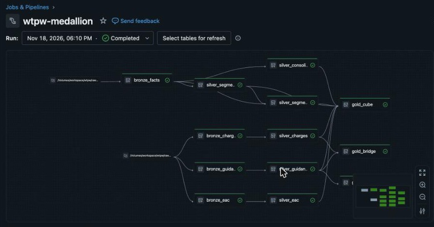
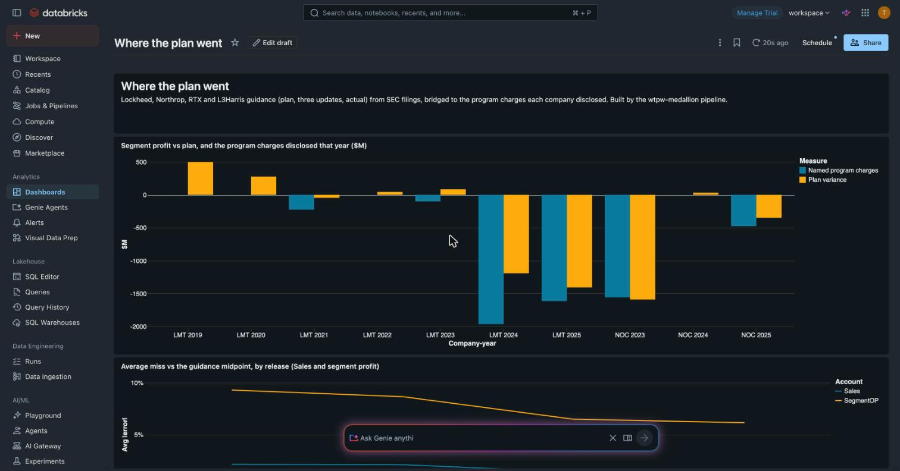

# Where the plan went

Every January, Lockheed Martin, Northrop Grumman, RTX and L3Harris publish a plan for the year. They update it three times, then report what happened. This project rebuilds that plan, forecast and actual history for 2019 to 2025 from SEC filings, in a planning cube on Databricks, and bridges each profit miss to the program charges the companies disclosed.

**Site:** https://tarangj.com/where-the-plan-went/ &nbsp;·&nbsp; **Memo:** [docs/memo.md](docs/memo.md) &nbsp;·&nbsp; **Workbook:** [outputs/where-the-plan-went.xlsx](outputs/where-the-plan-went.xlsx)

## What it found

<!-- findings:start (rendered from docs/readme-findings-template.md by python -m wtpw.readme_block) -->
- Of the company-years with a dollar plan for segment operating profit (10 in all), 4 missed by more than $300 million, and in each one the losses the company tied to named programs covered at least 98% of the miss. Lockheed 2025: plan $8,150M, sales volume +88M, three second-quarter reach-forward losses -1,615M, everything else +120M, actual $6,743M.
- The outlook did not come down until the release that reported the charge. When the charge landed in the fourth quarter there was no warning: Lockheed's October 2024 outlook was $7,475M, above its plan, and it reported $6,083M.
- Sales guidance is set to be beaten: actual sales beat the January midpoint in 61% of company-years and landed inside the guided range in only 13%.
<!-- findings:end -->

Every number above is generated into [outputs/numbers.csv](outputs/numbers.csv); this block and the memo are rendered from it, and the build fails if a number is typed by hand or the README drifts.

## How it works

```
SEC EDGAR (299 filings, cached once, sha256 manifest)
  -> XBRL instances parsed with dimensions kept (192,818 facts)  -> data/work/facts.parquet
  -> guidance, EAC adjustments, program charges copied with the quoting sentence -> curated/*.csv
  -> Unity Catalog volume -> Lakeflow pipeline on Databricks: bronze -> silver -> gold
                         \-> the same SQL on DuckDB locally  -> parity check, row by row
  -> outputs/numbers.csv -> memo, Excel FP&A pack, static site, AI/BI dashboard
```

Databricks Free Edition serverless compute cannot reach sec.gov, so filings are downloaded locally and uploaded to a volume. The pipeline, schema, volume and dashboard are all declared in the bundle (`databricks.yml`, `resources/`), so the whole workspace can be rebuilt from this repo.

| Databricks pipeline | AI/BI dashboard |
|---|---|
|  |  |

## The gates

`make gate` runs all of these; each was broken on purpose once to confirm it fails.

- **quote_check:** every curated row's quote must appear word for word in the cached filing, and every number in the row must be printed inside that quote as a whole number.
- **curation_contract:** fixed headers, closed enumerations, no duplicate keys.
- **reconcile:** no ambiguous fact selection; segments less intersegment eliminations tie to consolidated sales within 1% for 39 company-years; each update's printed prior range equals the earlier vintage (two exceptions, each proven by a phrase in the filing); release actuals equal the 10-K XBRL figures.
- **parity:** the gold tables Databricks builds equal the ones DuckDB builds.
- **tests:** parser, provenance, chain and bridge arithmetic, the synthetic program's EVM and revenue formulas, and the workbook's formulas evaluated outside Excel.

The method is in [docs/curation-contract.md](docs/curation-contract.md).

## The synthetic program

Public filings show a reach-forward loss only after it is booked. [docs/program-module.md](docs/program-module.md) builds one illustrative fixed-price development program, clearly labeled synthetic, to show the mechanism underneath: monthly earned value, three EAC formulas, cost-to-cost revenue with cumulative catch-up, a loss provision when the EAC passes the price, and Costpoint-style indirect rate pools.

## How it maps to enterprise tools

[docs/enterprise-crosswalk.md](docs/enterprise-crosswalk.md) maps the cube to OneStream's dimensions, the program ledger to Deltek Costpoint's project, organization and account structure, and the revenue logic to Dynamics 365 Finance. It is drawn from vendor documentation; I have not operated those systems.

## Reproduce

```bash
python3.12 -m venv .venv && .venv/bin/pip install -e '.[dev]'
export SEC_UA="Your Name you@example.com"   # SEC requires a contact in the User-Agent
make fetch facts program local findings gate   # downloads about 900 MB once, then runs offline
# Databricks (optional): databricks auth login --host <workspace> --profile pf
make upload deploy run parity
```

## Limits

Guidance is the public plan, not the internal budget. Ten bridge company-years is a small sample. L3Harris published its outlook from early 2022 to late 2023 only as images, so those vintages are missing. RTX and L3Harris do not guide segment profit in dollars, and General Dynamics and Boeing give no numeric guidance in their releases.

Data: SEC EDGAR filings (public). Code: MIT.
